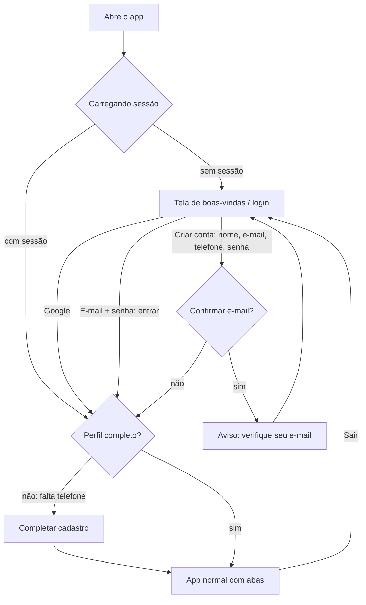

# Planejamento: login obrigatório no Lumen

Status: planejamento (nada implementado). Data: 2026-11-19.

> Atualização: a tela de login será construída **no novo frontend** (Preact + Vite + Capacitor), e não no React Native, e somente para Android, sem "Entrar com Apple". Ver [planejamento-migracao-frontend.md](planejamento-migracao-frontend.md).

## Objetivo

A partir de agora o cadastro é obrigatório para acessar o Lumen. O usuário pode se cadastrar com dados básicos (nome, e-mail e telefone) ou entrar com o Google.

## O que já existe

- **Autenticação:** Supabase Auth, com e-mail e senha, Google (OAuth PKCE pelo navegador) e Apple, em [AuthContext.tsx](../mobile/src/state/AuthContext.tsx).
- **Tela de login:** [AuthScreen.tsx](../mobile/src/screens/AuthScreen.tsx) existe, mas é opcional: abre como overlay a partir do Perfil, e o app inteiro funciona sem conta.
- **Perfil:** a tabela `profiles` tem só `display_name` e `avatar_url`, preenchida por trigger ([0001_profiles.sql](../supabase/migrations/0001_profiles.sql)). **Não existe campo de telefone.**
- **Sessão:** fica persistida e criptografada no aparelho ([supabaseClient.ts](../mobile/src/services/supabaseClient.ts)), então funciona offline depois do primeiro login.
- **Backend na VPS:** a API de liturgia é pública e não valida usuário.

Por isso, a maior parte do trabalho é colocar um **portão de entrada** e acrescentar o **telefone** ao cadastro. A autenticação em si já está pronta.

## Fluxo proposto

## Telas

1. **Boas-vindas / Login** (nova tela inicial, sem barra inferior)
   - Logo e nome do app, com a marca verde padrão, porque ainda não há liturgia carregada.
   - "Continuar com Google" em destaque. Em iOS, também "Continuar com Apple".
   - Separador "ou", e abaixo o formulário com e-mail e senha, "Esqueci minha senha" e a troca entre "Entrar" e "Criar conta".
   - Rodapé: "Ao continuar você aceita os Termos e a Política de Privacidade", com links.
2. **Criar conta:** nome, e-mail, telefone (com máscara e DDD), senha e confirmação.
3. **Completar cadastro:** aparece para quem entrou pelo Google/Apple sem telefone. O nome já vem preenchido, e o telefone é obrigatório.
4. **Verifique seu e-mail** e **Recuperar senha:** a primeira já existe, e a segunda precisa ser criada.

## Dados (Supabase)

Migração `0002_profile_phone.sql`:

- Novas colunas em `profiles`: `phone` (formato E.164, ex.: `+5511999999999`), `terms_accepted_at` e `profile_completed_at`.
- Trigger atualizado para ler o telefone do metadata do cadastro.
- O telefone é normalizado no app (DDD e +55 por padrão) e validado antes do envio.
- Os usuários que já existem ficam com `phone` vazio e passam pela tela "Completar cadastro" no próximo acesso.

## Mudanças no app

| Área | Mudança |
|---|---|
| [App.tsx](../mobile/App.tsx) | Portão: sem sessão mostra o login; com sessão e perfil incompleto mostra "Completar cadastro"; senão o app normal. |
| `AuthContext` | Aceitar telefone no `signUp`, expor `profileComplete`, adicionar `resetPassword` e `completeProfile`. |
| `AuthScreen` | Virar tela cheia sem botão fechar; incluir telefone, aceite de termos e "Esqueci minha senha". |
| [ProfileScreen.tsx](../mobile/src/screens/ProfileScreen.tsx) | Sair da conta volta ao login; editar telefone; **excluir conta**. |
| Utilitário novo | Validação e normalização de telefone, com testes. |

## Pontos importantes (não óbvios)

- **E-mail de confirmação:** o SMTP padrão do Supabase tem limite muito baixo de envios por hora. Com cadastro obrigatório, isso pode travar novos usuários. Recomendado configurar um SMTP próprio (ex.: Resend) antes de publicar.
- **Exclusão de conta:** a Play Store exige a opção dentro do app e uma URL na ficha da loja para apps com criação de conta. Isso exige uma função segura no Supabase (Edge Function), porque o app não pode apagar usuários sozinho.
- **Apple:** a App Store exige "Entrar com Apple" quando há login com Google. O código já existe e deve ficar visível no iOS.
- **Play Console:** com login obrigatório, o revisor precisa de uma **conta de teste** em "Acesso ao app". Também é preciso atualizar o formulário de Segurança dos dados (telefone passa a ser coletado) e a [Política de Privacidade](Politica-de-Privacidade.md), inclusive para a LGPD.
- **Offline:** quem já fez login continua entrando sem internet, pela sessão guardada. Só o primeiro login precisa de rede.
- **Backend:** o portão é só no app. A API de liturgia continua pública, o que é aceitável porque o conteúdo é público. Validar o token do usuário na VPS seria uma fase opcional posterior.

## Fases

1. **Backend e dados:** migração `0002`, SMTP próprio e ajuste das URLs de redirecionamento no Supabase.
2. **Núcleo:** validação de telefone com testes, `AuthContext` ampliado e portão no `App.tsx`.
3. **Telas:** boas-vindas/login, criar conta, completar cadastro e recuperar senha.
4. **Perfil:** sair, editar telefone e excluir conta (Edge Function).
5. **Publicação:** política de privacidade, termos, formulário da Play, conta de teste, build e envio para a trilha interna.

## Decisões fechadas (2026-11-20)

| # | Tema | Decisão |
|---|---|---|
| 1 | Senha | **E-mail + senha**, com "Esqueci minha senha" |
| 2 | Telefone | **Obrigatório, sem verificação por SMS** (só validação de formato) |
| 3 | Telefone no Google | **Obrigatório**, na tela "Completar cadastro" |
| 4 | Telefone único | **Não** (sem SMS, um número digitado errado bloquearia o dono real) |
| 5 | Termos de uso | Já existem: [Termos-de-Uso.md](Termos-de-Uso.md) |
| 6 | Usuários atuais | **Na hora**: a primeira abertura da versão nova já pede login ou completar cadastro; os dados locais continuam no aparelho |
| 7 | iOS | Fora do escopo; sem "Entrar com Apple" |

## Decisões em aberto (histórico, todas fechadas acima)

1. **Senha:** o cadastro por e-mail continua com senha, como hoje? A alternativa é entrar por código enviado ao e-mail, sem senha. Recomendação: manter a senha.
2. **Telefone:** só um dado de contato, sem verificação (sugestão), ou verificado por SMS? O SMS exige um provedor pago como o Twilio e gera custo por usuário.
3. **Telefone no Google:** obrigatório na tela "Completar cadastro" (sugestão) ou opcional?
4. **Telefone único:** impedir duas contas com o mesmo número?
5. **Termos de uso:** já existem ou é preciso redigir um texto-base? Só a política de privacidade existe hoje.
6. **Usuários atuais:** devem completar o telefone na hora (sugestão) ou ter alguns dias de tolerância?
7. **iOS:** o app vai sair na App Store em breve? Isso define se o "Entrar com Apple" entra neste escopo.
